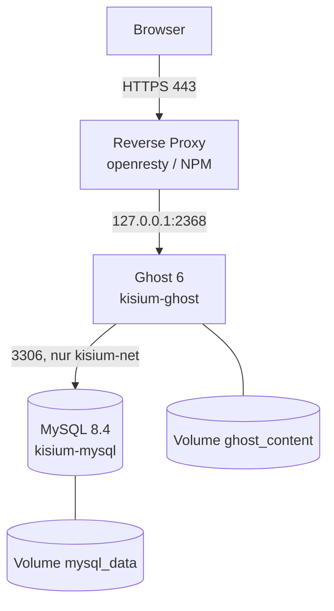

# Homelab – ein VPS, Docker und die Doku dazu

Ein Blog braucht mehr als einen Container: TLS, eine Datenbank, Backups und Updates.
Dieses Repo dokumentiert, wie ich das auf einem einzelnen VPS betreibe – inklusive der
Stellen, die noch offen sind.

> **Stand:** 03.11.2026. Belegt sind Compose-Datei, HTTP-Header und ein Blick auf den
> Server. Was ich nicht belegen kann, steht als `TODO` – nicht als Behauptung.

## Architektur



| Dienst | Zweck | Port intern | erreichbar über |
|---|---|---|---|
| Reverse Proxy (openresty / NPM) | TLS, HTTP→HTTPS, Routing | 80, 443 | öffentlich |
| Ghost 6 | Blog | `127.0.0.1:2368` | nur über den Proxy |
| MySQL 8.4 | Datenbank | 3306 im Netz `kisium-net` | nicht von außen |
| n8n | Automatisierung | `TODO` | `TODO` |
| Paperless | Dokumentenarchiv | `TODO` | `TODO` |
| Ollama + Open WebUI | lokale Modelle | `TODO` | `TODO` |

Die letzten drei Dienste laufen laut Blogartikel auf derselben Maschine, ihre
Compose-Dateien sind aber nicht in diesem Repo. Deshalb `TODO` statt geratener Ports.
Details: [docs/architektur.md](docs/architektur.md).

## Sicherheit

- **Ghost lauscht nur auf `127.0.0.1:2368`.** Der Port ist nicht im Internet erreichbar;
  jeder Zugriff muss über den Proxy mit TLS laufen. Ohne diese Bindung wäre der Blog
  zusätzlich per HTTP und ohne Proxy-Regeln erreichbar.
- **MySQL veröffentlicht keinen Port.** Die Datenbank ist nur im Docker-Netz
  `kisium-net` ansprechbar. Ein offener 3306-Port ist einer der häufigsten Funde bei
  automatisierten Scans.
- **Zugangsdaten stehen nur in `.env`.** `${MYSQL_PASSWORD:?…}` bricht den Start ab,
  wenn ein Wert fehlt – statt mit einem leeren Passwort weiterzulaufen. Die Datei ist
  per `.gitignore` ausgeschlossen.
- **TLS endet am Proxy, HTTP wird umgeleitet.** Das Zertifikat ist von Let's Encrypt
  (gültig bis 30.01.2027); `http://` antwortet mit `301` auf HTTPS.
- **Keine Daten an Dritte.** Gravatar, Update-Ping und RPC sind in Ghost abgeschaltet.
  Ein Blog über den eigenen Weg muss nicht nebenbei verraten, wer ihn liest.
- **Healthcheck vor Abhängigkeit.** Ghost startet erst, wenn MySQL
  `service_healthy` meldet. Das verhindert eine Neustart-Schleife beim Booten.

**Noch nicht umgesetzt** (siehe [docs/hardening.md](docs/hardening.md)): HSTS-Header,
SSH-Härtung, Firewall, automatische Updates, `cap_drop`/`no-new-privileges` in diesem
Compose. Diese Punkte sind als offen markiert, nicht als erledigt.

## Backup & Recovery

Gesichert werden die MySQL-Datenbank und das Volume `ghost_content` – mit
[`scripts/backup.sh`](scripts/backup.sh). Der Restore ist in
[docs/backup-restore.md](docs/backup-restore.md) beschrieben und mit
[`scripts/restore-test.sh`](scripts/restore-test.sh) automatisierbar; am 03.11.2026
lief er gegen eine lokale Testinstanz in 43 Sekunden mit HTTP 200 und identischen
Datenständen. Der Restore der Produktion steht noch aus.

## Betrieb

```bash
cd compose
cp .env.example .env          # Werte eintragen, danach: chmod 600 .env
docker compose up -d
docker compose ps             # Healthchecks beobachten
docker compose logs -f ghost  # Logs
```

**Update:**

```bash
cd compose
docker compose pull
docker compose up -d
```

**Sicherung und Prüfung** (aus dem Wurzelverzeichnis):

```bash
./scripts/backup.sh
./scripts/health-check.sh
./scripts/restore-test.sh   # eigenes Wegwerf-Projekt, Produktion unberührt
```

Vor einem Ghost-Major-Upgrade: Backup anlegen und den Restore-Test wiederholen.
MySQL bleibt auf `8.4` – ein Sprung auf eine neue Major-Version ist ein eigener Vorgang.

## Was ich dabei gelernt habe

1. **Ein Container ist keine Sicherheitsgrenze per Default.** Ohne `USER` läuft der
   Prozess als root. Bei offiziellen Images ist der User vorgegeben – nachsehen, nicht
   annehmen: `docker inspect <container> --format '{{.Config.User}}'`.
2. **Der Fehler lag selten da, wo ich gesucht habe.** Der Dienst lief im Container,
   war von außen aber nicht erreichbar – die Anwendung lauschte auf Loopback, der
   Port-Proxy kam aus dem Bridge-Netz. Seitdem prüfe ich von außen nach innen:
   DNS → Port → Proxy → Container → Anwendung.
3. **Ein Backup ohne Restore-Test ist kein Backup.** Ein Skript, das ohne Fehler
   durchläuft, beweist nur, dass es durchläuft. Erst das Zurückspielen zeigt, ob die
   Daten vollständig sind.
4. **Zombie-Prozesse sind ein Symptom.** Auf der Maschine standen am 02.11.2026
   1.057 Zombies, der Swap war zu 48 % belegt. Die Ursache ist noch nicht gefunden –
   das steht als offener Punkt in [docs/lessons-learned.md](docs/lessons-learned.md).

## Verweise

- Blog: [kisium.de](https://kisium.de) – Erfahrungsbericht
  [Mein Homelab – drei teure Fehler](https://kisium.de/mein-homelab/)
- [docs/architektur.md](docs/architektur.md) – Komponenten, Ports, Netzwerk
- [docs/hardening.md](docs/hardening.md) – Maßnahmen, Begründung, Lücken
- [docs/backup-restore.md](docs/backup-restore.md) – Strategie und Restore-Ablauf
- [docs/lessons-learned.md](docs/lessons-learned.md) – Fehler und was daraus wurde
