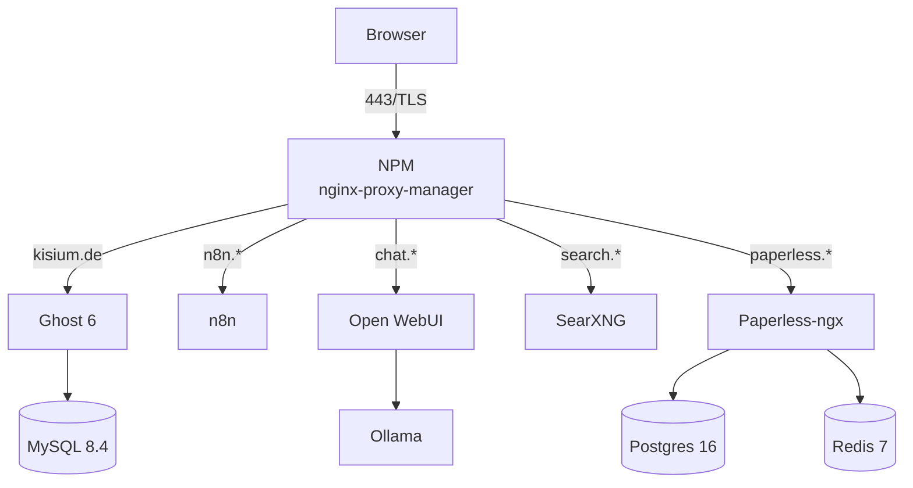

# Homelab – ein VPS, zwei Compose-Projekte, ein Reverse Proxy

Auf einem gemieteten VPS laufen zehn Container: Blog, Automatisierung, Dokumentenarchiv,
Suche, lokale Sprachmodelle und der Reverse Proxy davor. Dieses Repo dokumentiert, was
läuft, wie es abgesichert ist – und was noch offen ist.

> **Stand:** 03.11.2026. Belegt sind Compose-Dateien, `sshd -T`, `ufw status`,
> Docker-Inspect und zwei Restore-Tests. Was ich nicht belegen kann, steht als `TODO`.

## Architektur



| Dienst | Zweck | Port intern | erreichbar über |
|---|---|---|---|
| NPM | TLS, HTTP→HTTPS, Routing | 80, 443; Admin `127.0.0.1:81` | öffentlich |
| Ghost 6 | Blog | `127.0.0.1:2368` | `kisium.de` |
| MySQL 8.4 | Blog-Datenbank | 3306 im Netz `kisium-net` | nicht von außen |
| n8n | Automatisierung | `127.0.0.1:5678` | `n8n.<DEINE_DOMAIN>` |
| Open WebUI | Chat-Oberfläche | `127.0.0.1:8080` | `chat.<DEINE_DOMAIN>` |
| SearXNG | Metasuche | `127.0.0.1:8888` → 8080 | `search.<DEINE_DOMAIN>` |
| Paperless-ngx | Dokumentenarchiv | 8000 intern | `paperless.<DEINE_DOMAIN>` |
| Postgres 16 / Redis 7 | Paperless-DB und Broker | intern | nicht von außen |
| Ollama | lokale Modelle | 11434 intern | nur über Open WebUI |

NPM hängt in beiden Netzen (`homeserver_default` und `kisium-net`) und ist damit die
einzige Brücke zwischen den Compose-Projekten. Die Verbindung zu `kisium-net` steht als
externes Netz in der Stack-Compose – sie war vorher manuell gesetzt und ging beim
Recreate verloren. Details, Routen und Belege:
[docs/architektur.md](docs/architektur.md).

## Sicherheit

- **SSH nur mit Schlüssel.** `sshd -T` am 03.11.2026: `passwordauthentication no`,
  `permitrootlogin without-password`, `maxauthtries 6`. Ein Passwort-Login ist nicht
  möglich; der Root-Login nur per Key.
- **Firewall standardmäßig dicht.** UFW ist aktiv, eingehend `deny`, offen sind nur
  22/tcp sowie 80/443/tcp – der Rest wird verworfen.
- **Sicherheitsupdates laufen automatisch.** `unattended-upgrades` ist aktiv und
  enabled; automatische Neustarts sind aus, damit der Blog nicht ungeplant neu startet.
- **NPM-Admin nur lokal.** Die Oberfläche lauscht auf `127.0.0.1:81`, nicht im Internet.
  Kein zweiter Weg am Proxy vorbei.
- **Datenbanken ohne öffentlichen Port.** MySQL und Postgres sind nur in ihren
  Docker-Netzen erreichbar. Ein offener 3306/5432-Port ist ein häufiges Scan-Ziel.
- **TLS endet am Proxy, HTTP wird umgeleitet.** Let's-Encrypt-Zertifikat, gültig bis
  30.01.2027; `http://` antwortet mit `301`, HSTS ist auf allen fünf Hosts gesetzt.
- **Keine Daten an Dritte.** Gravatar, Update-Ping und RPC sind in Ghost abgeschaltet.
- **Healthcheck ohne Zombie-Leck.** Der Ghost-Check nutzt `nc -z` statt `wget`; `init: true`
  sorgt dafür, dass Kindprozesse eingesammelt werden. Vorher standen 1.354 Zombies auf
  dem Server. Alle Container laufen zusätzlich mit `no-new-privileges`.

**Noch offen:** Container-Härtung über `no-new-privileges` hinaus (`cap_drop`, non-root),
Fail2ban, Tailscale (nicht installiert), Root-Login auf `no`. Details:
[docs/hardening.md](docs/hardening.md) und
[docs/hardening-offen.md](docs/hardening-offen.md).

## Backup & Recovery

Paperless wird täglich um 03:30 gesichert (DB-Dump, Daten, Medien, Export, `.env`),
Ghost seit dem 03.11. um 03:00 (DB-Dump, Content-Volume). Beide Sicherungen werden
täglich in ein separates Compose-Projekt zurückgespielt: Paperless am 03.11. mit 150
Dokumenten, 3 Benutzern, 56 Tags und 443 Media-Dateien (HTTP 302), Ghost mit 10
Beiträgen, 1 Benutzer und 129 Einstellungen (HTTP 200, 47 Sekunden). Ablauf und die
gefundenen Fehler: [docs/backup-restore.md](docs/backup-restore.md).

## Betrieb

```bash
# Stack-Status
cd /opt/stack  && docker compose ps
cd /opt/kisium && docker compose ps

# Logs
docker logs -f kisium-ghost
docker logs -f npm

# Sicherungen
sudo /opt/kisium/backup.sh
sudo /opt/backups/paperless-backup.sh

# Restore-Tests
sudo /opt/backups/run-restore-test.sh     # Paperless
./scripts/restore-test.sh                 # Ghost, eigenes Wegwerf-Projekt
```

**Update:** Die `latest`-Images sind auf Digests gepinnt. Ein Update heißt bewusst:
neuen Digest wählen, `docker compose up -d`, Health prüfen. Vorher sichern.

## Was ich dabei gelernt habe

1. **Ein Healthcheck kann das System kaputt machen.** `wget --spider` folgte dem
   `301` von `http://127.0.0.1:2368` auf `https://127.0.0.1:2368` und sprach TLS mit
   einem HTTP-Port. Jeder Fehlversuch hinterließ einen `ssl_client`-Zombie; nach elf
   Stunden waren es 1.354. `nc -z` und `init: true` haben beides behoben.
2. **Ein Restore-Test, der immer fehlschlägt, ist kein Test.** Der Paperless-Test lief
   zwei Tage auf ein gelöschtes Backup, weil der Wrapper dem Skript den Pfad nicht
   übergab. Ohne den Blick ins Log wäre das nie aufgefallen.
3. **Ein Container ist keine Sicherheitsgrenze per Default.** Ohne `USER` läuft der
   Prozess als root. Bei offiziellen Images ist der User vorgegeben – nachsehen, nicht
   annehmen: `docker inspect <container> --format '{{.Config.User}}'`.
4. **Der Fehler lag selten da, wo ich gesucht habe.** Der Dienst lief im Container, war
   von außen aber nicht erreichbar – die Anwendung lauschte auf Loopback, der Port-Proxy
   kam aus dem Bridge-Netz. Seitdem prüfe ich von außen nach innen:
   DNS → Port → Proxy → Container → Anwendung.
5. **Dokumentation ist Teil des Betriebs.** Ein Skript, das läuft, beweist nicht, dass
   die Daten sicher sind. Erst der dokumentierte Restore-Test macht aus einer Annahme
   einen Beleg.

## Verweise

- Blog: [kisium.de](https://kisium.de) – Erfahrungsbericht
  [Mein Homelab – drei teure Fehler](https://kisium.de/mein-homelab/)
- [docs/architektur.md](docs/architektur.md) – Komponenten, Netze, Ports, Routen
- [docs/hardening.md](docs/hardening.md) – umgesetzte Maßnahmen mit Begründung
- [docs/hardening-offen.md](docs/hardening-offen.md) – offene Punkte und Prüfwege
- [docs/backup-restore.md](docs/backup-restore.md) – Backup, Restore-Tests, Fehler
- [docs/lessons-learned.md](docs/lessons-learned.md) – Fehler und was daraus wurde
