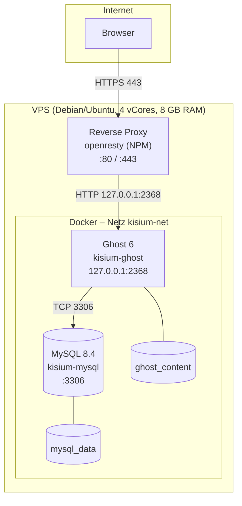

# Architektur

Ein einzelner VPS, Docker Compose und ein Reverse Proxy davor. Diese Datei beschreibt,
was belegt ist – und trennt das von dem, was ich nur aus dem Betrieb weiß.

## Überblick

## Komponenten

| Komponente | Image / Version | Container | Beleg |
|---|---|---|---|
| Blog | `ghost:6-alpine` | `kisium-ghost` | `compose/docker-compose.yml` |
| Datenbank | `mysql:8.4` | `kisium-mysql` | `compose/docker-compose.yml` |
| Reverse Proxy | openresty (NPM) | `TODO` | HTTP-Header `Server: openresty` am 02.11.2026 |
| TLS | Let's Encrypt | – | `openssl s_client`, gültig 01.11.2026–30.01.2027 |

**Nicht belegt:** Ob der Proxy als Host-Prozess oder als Container läuft. Der Header
beweist die Software, nicht die Betriebsart. Die Bindung `127.0.0.1:2368` spricht für
einen Proxy auf dem Host oder für einen Container mit `network_mode: host`.

## Netzwerk und Ports

| Port | Dienst | Bindung | Von außen erreichbar |
|---|---|---|---|
| 80 | Proxy | `0.0.0.0` | ja, antwortet mit `301` auf HTTPS |
| 443 | Proxy | `0.0.0.0` | ja, TLS |
| 2368 | Ghost | `127.0.0.1` | nein, nur über den Proxy |
| 3306 | MySQL | nur `kisium-net` | nein, kein Port-Mapping |

Das Docker-Netz `kisium-net` wird in der Compose-Datei explizit benannt. Ghost und MySQL
sind darüber verbunden; MySQL hat keinen veröffentlichten Port.

**DNS:** Welche A-/AAAA-Records auf den Server zeigen, ist nicht dokumentiert (`TODO`).
**IPv6:** Ob der Server per IPv6 erreichbar ist, ist nicht dokumentiert (`TODO`).

## Request-Pfad

1. Der Browser löst die Domain auf die Server-IP auf.
2. Port 80 antwortet mit `301 Moved Permanently` auf HTTPS.
3. Der Proxy terminiert TLS und leitet an `127.0.0.1:2368` weiter.
4. Ghost rendert die Seite und liest Inhalte aus MySQL über `mysql:3306`.
5. Antwort zurück über den Proxy.

Der Proxy ist damit die einzige Stelle, an der TLS und Weiterleitungen konfiguriert sind.
Ghost selbst kennt kein TLS.

## Speicher

| Volume | Inhalt | Sicherung |
|---|---|---|
| `ghost_content` | Theme, Bilder, Uploads | Teil des Backups (`TODO`: Skript) |
| `mysql_data` | Datenbankdateien | Teil des Backups (`TODO`: Dump) |

Server-Platte am 02.11.2026: 192,69 GB gesamt, 25,6 % belegt.

## Host

| | |
|---|---|
| Hoster | Webtropia (myLoc) – laut Blogartikel; im Auftrag stand Hetzner (`TODO`: klären) |
| CPU / RAM / Disk | 4 vCores / 8 GB / 200 GB SSD |
| OS | Debian oder Ubuntu – nicht belegt; das Banner meldet „ESM not enabled“, was auf Ubuntu hindeutet (`TODO`: `cat /etc/os-release`) |
| Mailversand | SMTP über Brevo, konfiguriert über `.env` |

## Weitere Dienste

Laut Blogartikel und Lebenslauf laufen auf derselben Maschine außerdem n8n, Paperless
und eine lokale LLM-Umgebung (Ollama + Open WebUI). Für sie gilt:

- Es gibt **keine** Compose-Datei, keine Portangabe und keine Konfiguration in diesem Repo.
- Ob sie im selben Docker-Netz hängen, ist nicht bekannt.
- Deshalb stehen sie in der README nur mit `TODO` – nicht mit geratenen Werten.

## Offene Punkte

- [ ] Proxy-Konfiguration exportieren (NPM: Proxy Hosts → Advanced, oder
      `/data/nginx/proxy_host/*.conf` im Container)
- [ ] Betriebsart des Proxys dokumentieren (Host oder Container)
- [ ] DNS-Records (A, AAAA, MX, TXT) dokumentieren
- [ ] OS und Kernel-Version festhalten
- [ ] n8n, Paperless, Ollama/Open WebUI mit Ports und Netzen ergänzen
- [ ] Hoster klären: Webtropia oder Hetzner
