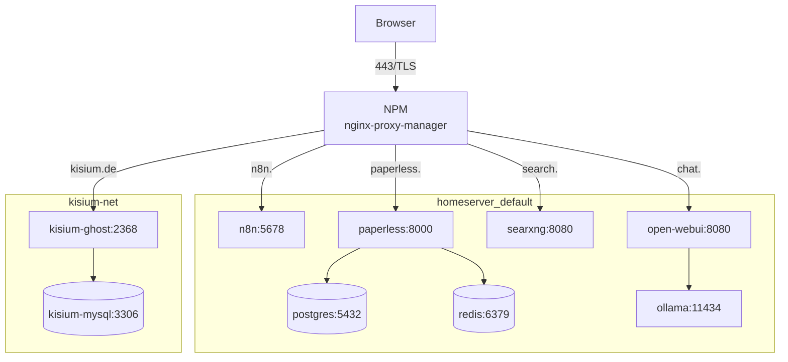

# Architektur

Ein VPS, zwei Compose-Projekte, zehn Container. NPM ist die einzige Brücke zwischen
beiden Netzen. Diese Datei trennt belegte Fakten von offenen Fragen.

## Überblick

NPM ist Mitglied beider Netze (`homeserver_default` und `kisium-net`). Deshalb erreicht
der Proxy sowohl `kisium-ghost` als auch `n8n`, `open-webui`, `searxng` und `paperless`
über deren Container-Namen. Die Verbindung zu `kisium-net` ist in der Stack-Compose als
`external: true` hinterlegt – sie war vorher manuell per `docker network connect`
gesetzt und ging beim Recreate verloren.

## Komponenten

| Container | Image | Zweck | Netz | Als root? |
|---|---|---|---|---|
| `npm` | `jc21/nginx-proxy-manager:latest` | TLS, Routing | beide | ja |
| `kisium-ghost` | `ghost:6-alpine` | Blog | `kisium-net` | ja (Entrypoint wechselt zu uid 1000) |
| `kisium-mysql` | `mysql:8.4` | Blog-DB | `kisium-net` | ja |
| `n8n` | `docker.n8n.io/n8nio/n8n:latest` | Automatisierung | `homeserver_default` | nein (`node`) |
| `open-webui` | `ghcr.io/open-webui/open-webui:latest` | Chat | `homeserver_default` | ja (`0:0`) |
| `searxng` | `searxng/searxng:latest` | Metasuche | `homeserver_default` | ja |
| `paperless` | `ghcr.io/paperless-ngx/paperless-ngx:latest` | Dokumente | `homeserver_default` | ja |
| `paperless-db` | `postgres:16` | Paperless-DB | `homeserver_default` | ja |
| `paperless-broker` | `redis:7` | Paperless-Queue | `homeserver_default` | ja |
| `ollama` | `ollama/ollama:latest` | lokale Modelle | `homeserver_default` | ja |

Die Root-Spalte ist ein Befund, kein Entwurf: `docker inspect … .Config.User` ist bei
allen außer `n8n` leer, bei `open-webui` sogar explizit `0:0`. Alle Container laufen
zusätzlich mit `no-new-privileges`; die `latest`-Images sind auf die am 03.11.2026
laufenden Digests gepinnt. Das steht als offener Punkt in
[hardening-offen.md](hardening-offen.md).

## Netze und Ports

| Port | Dienst | Bindung | Von außen |
|---|---|---|---|
| 80 | NPM | `0.0.0.0` | ja, `301` auf HTTPS |
| 443 | NPM | `0.0.0.0` | ja, TLS |
| 81 | NPM-Admin | `127.0.0.1` | nein |
| 2368 | Ghost | `127.0.0.1` | nein |
| 5678 | n8n | `127.0.0.1` | nein |
| 8080 | Open WebUI | `127.0.0.1` | nein |
| 8888 → 8080 | SearXNG | `127.0.0.1` | nein |
| 8000 | Paperless | nur Netz | nein |
| 3306 / 5432 / 6379 / 11434 | MySQL / Postgres / Redis / Ollama | nur Netz | nein |

UFW lässt eingehend ausschließlich 22, 80 und 443 zu. Alle anderen Dienste sind nur über
den Proxy oder lokal erreichbar.

## Routen im Proxy

| Host | Upstream | Port |
|---|---|---|
| `kisium.de` | `kisium-ghost` | 2368 |
| `n8n.<DEINE_DOMAIN>` | `n8n` | 5678 |
| `chat.<DEINE_DOMAIN>` | `open-webui` | 8080 |
| `search.<DEINE_DOMAIN>` | `searxng` | 8080 |
| `paperless.<DEINE_DOMAIN>` | `paperless` | 8000 |

Quelle: die fünf `proxy_host/*.conf` im NPM-Container. Die Domains sind hier durch
Platzhalter ersetzt; im Repo steht keine echte Domain außer dem öffentlichen Blog-Link.

## Request-Pfad

1. DNS löst die Domain auf die Server-IP auf.
2. Port 80 antwortet mit `301` auf HTTPS.
3. NPM terminiert TLS (Let's Encrypt) und setzt die Proxy-Header.
4. NPM leitet an den Container-Namen weiter, z. B. `kisium-ghost:2368`.
5. Ghost liest aus `kisium-mysql:3306`; Paperless aus Postgres/Redis; Open WebUI aus Ollama.
6. Antwort zurück über NPM.

## Speicher

| Volume | Inhalt |
|---|---|
| `kisium_ghost_content` | Theme, Bilder, Uploads |
| `kisium_mysql_data` | Blog-Datenbank |
| `homeserver_paperless_data` / `_media` / `_pgdata` / `_redisdata` | Paperless |
| `homeserver_webui` | Open-WebUI-Daten |
| `homeserver_ollama` | Modelle |
| `homeserver_searxng_cache` | Such-Cache |
| `homeserver_n8n` | n8n-Daten |

## Host

| | |
|---|---|
| Hoster | Webtropia (myLoc), KVM |
| CPU / RAM / Disk | 4 vCores / 8 GB / 193 GB (26 % belegt) |
| OS | Ubuntu 24.04.5 LTS, Kernel 6.8.0-147-generic |
| Uptime | 14 Tage (03.11.2026) |
| RAM / Swap | 4,6 GB belegt, 3,3 GB verfügbar / 2 GB Swap, 50 % belegt |
| Docker | 29.9.2, Compose v2 |

## Belege

| Fakt | Beleg |
|---|---|
| Container, Images, Ports | `docker ps`, `docker inspect` |
| Netze und Routen | `docker network inspect`, NPM `proxy_host/*.conf` |
| SSH-Konfiguration | `sshd -T` |
| Firewall | `ufw status verbose` |
| Updates | `systemctl is-active/is-enabled unattended-upgrades` |
| OS/Kernel | `hostnamectl`, `uname -r` |
| Restore-Tests | `/var/log/restore-test.log`, eigener Lauf am 03.11.2026 |

## Offene Punkte

- [ ] Tailscale ist **nicht** installiert (`command -v tailscale` leer). Der Auftrag
      nannte es; entweder nachinstallieren oder aus der Beschreibung streichen.
- [ ] Fail2ban ist nicht aktiv. SSH ist Key-only, daher optional – aber ungeprüft.
- [ ] Container-Härtung: `no-new-privileges` ist aktiv; `cap_drop` und non-root fehlen.
- [ ] Root-Login ist per Key erlaubt; ein dauerhafter Admin-Benutzer mit sudo fehlt.
